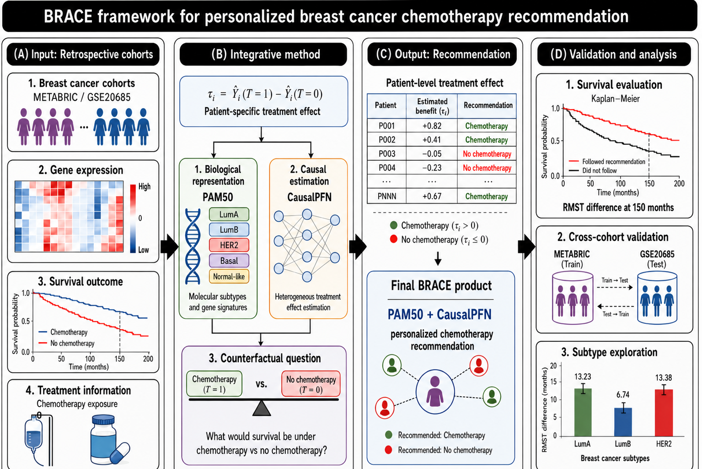

# BRACE: Biologically-grounded Recommendation And Causal Estimation for Personalized Breast Cancer Chemotherapy

BRACE is a framework for **personalized breast cancer chemotherapy recommendation**. It pairs a
compact, clinically established biological representation (the **PAM50** molecular signature) with a
causal foundation model (**CausalPFN**) to estimate each patient's individual treatment effect of
chemotherapy, and converts those estimates into binary recommendations that are validated against
survival outcomes.



## Overview

For each patient *i*, BRACE estimates the individual treatment effect
**τ̂ᵢ = Ŷᵢ(T=1) − Ŷᵢ(T=0)** (survival under chemotherapy vs. no chemotherapy) and recommends
chemotherapy when **τ̂ᵢ > 0**. Patients are then stratified by whether their *observed* treatment
matched the recommendation ("Followed" vs. "Not Followed"), and the two groups are compared with
Kaplan–Meier curves, log-rank tests, and restricted mean survival time (RMST) differences at a
150-month horizon.

- **Cohorts:** METABRIC (development/evaluation) and GSE20685 (external, cross-cohort).
- **Biological input:** PAM50, benchmarked against correlation rankings, expert-curated gene
  panels, and network-controllability (control-theory) gene sets.
- **Estimator:** CausalPFN, benchmarked against a random baseline, a causal tree, and a causal
  survival forest.

## Repository structure

```
BRACE/
├── master.R              # main pipeline: build data, fit, recommend, evaluate
├── hte.R                 # treatment-effect estimators (CausalPFN, causal tree, CSF)
├── feature_selection.R   # biological-input selection (correlation, gene sets, etc.)
├── metrics.R             # survival evaluation (KM, log-rank, RMST, confusion matrix)
├── process_eval_data.R   # post-processing of evaluation outputs
├── visualisations.R      # figure generation
├── utils.R               # helper functions
└── Workflow.png          # framework overview figure
```

## Requirements

- **R** (≥ 4.2) with: `survival`, `survRM2`, `grf`, `causalTree`, `dplyr`, `readr`.
- **Python** (3.12) with the `causalpfn` package (v0.1.4) for the CausalPFN estimator
  (`pip install causalpfn==0.1.4`).

## Data

- **METABRIC** — available through [cBioPortal](https://www.cbioportal.org/).
- **GSE20685** — available through the
  [Gene Expression Omnibus](https://www.ncbi.nlm.nih.gov/geo/) (e.g. via the `GEOquery` R package).

Raw patient data are not redistributed in this repository; obtain them from the sources above and
place them where `master.R` expects them.

## Usage

```r
source("master.R")   # fit BRACE, generate recommendations, and evaluate
```

`master.R` calls the estimators in `hte.R` (including CausalPFN), then evaluates the resulting
recommendations with the functions in `metrics.R` and produces figures via `visualisations.R`.

## Authors

Deanna Elizabeth Parkinson, Thuc Duy Le, and Sindy Licette Pinero 

## License

MIT License

Copyright (c) 2026 Sindy Licette Pinero

Permission is hereby granted, free of charge, to any person obtaining a copy
of this software and associated documentation files (the "Software"), to deal
in the Software without restriction, including without limitation the rights
to use, copy, modify, merge, publish, distribute, sublicense, and/or sell
copies of the Software, and to permit persons to whom the Software is
furnished to do so, subject to the following conditions:

The above copyright notice and this permission notice shall be included in all
copies or substantial portions of the Software.

THE SOFTWARE IS PROVIDED "AS IS", WITHOUT WARRANTY OF ANY KIND, EXPRESS OR
IMPLIED, INCLUDING BUT NOT LIMITED TO THE WARRANTIES OF MERCHANTABILITY,
FITNESS FOR A PARTICULAR PURPOSE AND NONINFRINGEMENT. IN NO EVENT SHALL THE
AUTHORS OR COPYRIGHT HOLDERS BE LIABLE FOR ANY CLAIM, DAMAGES OR OTHER
LIABILITY, WHETHER IN AN ACTION OF CONTRACT, TORT OR OTHERWISE, ARISING FROM,
OUT OF OR IN CONNECTION WITH THE SOFTWARE OR THE USE OR OTHER DEALINGS IN THE
SOFTWARE.
